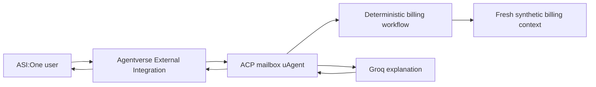

# RAGrets — Agentverse Cloud Billing Investigator

RAGrets is a Fetch.ai uAgent that answers cloud billing questions through Agentverse and ASI:One. It implements the Agent Chat Protocol (ACP), acknowledges messages immediately, performs deterministic billing analysis, and uses Groq only to explain the supplied billing evidence.

There is no Streamlit interface or local web dashboard. The public interface is the Agentverse/ASI:One chat experience.

## What the agent does

- Accepts ACP chat messages from Agentverse and ASI:One.
- Analyzes billing records stored in the configured SQLite database.
- Ingests supported PDF attachments sent in ASI:One chat, then can answer the accompanying billing question.
- Clears active billing records, invoices, and evidence when the user sends `reset`; audit history and prior reports are retained.
- Detects changes across billing periods by service, region, and resource.
- Reconciles billing detail with invoices.
- Uses Groq for evidence-based answers with source record IDs.
- Maintains isolated temporary history for each sender, limited to 20 messages.
- Clears a sender's history on ACP start or end session messages.
- Does not modify cloud resources or access cloud-provider accounts.

The bundled sample data is fictional and contains September and October 2026 costs for `demo-acct`. It includes a new Compute resource (`oct-2`) and new Storage cost (`oct-3`) in October. The live chat handler reads the configured database; sample/demo data is not automatically restored after `reset`.

### PDF attachment support

- Attach one PDF to an ASI:One message. The agent downloads it over HTTPS, validates the PDF bytes, and tries to parse it with the existing RAGrets synthetic-bill layout parser.
- The current parser supports the specific synthetic cloud-bill format used for testing. It is not a general parser for arbitrary AWS/Azure/GCP invoice layouts, and scanned PDFs without selectable text are not supported.
- Downloads are limited to 20 MB and, by default, only `res.cloudinary.com` is allowed. If your trusted file provider uses another domain, configure `RAGRETS_ATTACHMENT_ALLOWED_HOSTS` with a comma-separated allowlist. Redirect destinations are validated too.
- If extraction or schema validation fails, the attachment is rejected rather than silently imported.

## Architecture



The agent is implemented in [agent/ragrets_agent.py](agent/ragrets_agent.py). Its data adapter is [src/ragrets/agent_service.py](src/ragrets/agent_service.py).

## Requirements

- Python 3.11–3.13
- Groq API key
- Agentverse account and API key
- A private uAgent seed phrase
- A continuously available public HTTPS endpoint ending in `/submit`

## Setup

```powershell
cd "C:\Users\Vikrant Tewari\Documents\Codex\2026-10-22\files-mentioned-by-the-user-ragrets\work\RAGrets-cloud-billing"
py -m venv .venv
.\.venv\Scripts\Activate.ps1
python -m pip install --upgrade pip
python -m pip install -e ".[dev]"
```

Create `.env` using `.env.example`:

```env
RAGRETS_GROQ_API_KEY=your_groq_api_key
RAGRETS_GROQ_MODEL=openai/gpt-oss-20b
AGENT_SEED_PHRASE=a_new_private_seed_phrase
AGENTVERSE_KEY=your_agentverse_api_key
RAGRETS_AGENT_NAME=ragrets-billing-agent
RAGRETS_AGENT_PORT=8000
RAGRETS_AGENT_ENDPOINT=https://your-public-domain.example/submit
```

Load `.env` into the current PowerShell terminal:

```powershell
Get-Content .env | ForEach-Object {
    if ($_ -match '^\s*([^#][^=]*)=(.*)$') {
        [Environment]::SetEnvironmentVariable($matches[1].Trim(), $matches[2].Trim().Trim('"'), 'Process')
    }
}
```

Run locally:

```powershell
python agent\ragrets_agent.py
```

The local process listens on port 8000. For a local smoke test, leave `RAGRETS_AGENT_ENDPOINT` empty. ASI:One cannot reach a local-only server.

## Deploy a public agent

Build and run the included Docker image on a host that provides a public HTTPS URL:

```powershell
docker build -t ragrets-agent .
docker run --rm -p 8000:8000 --env-file .env ragrets-agent
```

Configure your deployment platform's HTTPS domain so its `/submit` route forwards to container port `8000`. Set that full public URL as `RAGRETS_AGENT_ENDPOINT` before starting the container. Keep the same `AGENT_SEED_PHRASE` across restarts so the uAgent address stays stable.

## Register with Agentverse and ASI:One

1. Start the publicly reachable agent and confirm its `/submit` endpoint is available.
2. In Agentverse, choose **Launch an Agent → External Integration → uAgents**.
3. Enter `ragrets-billing-agent` and the exact value of `RAGRETS_AGENT_ENDPOINT`.
4. Add discovery terms: `cloud billing`, `cost analysis`, `invoice reconciliation`, `FinOps`, `AWS`, `Azure`, and `GCP`.
5. Complete Agentverse's registration evaluation, then open the agent dashboard.
6. Test it from ASI:One with: “Why did the October bill increase?”

The uAgents SDK publishes the ACP manifest when the process starts. Registration and ASI:One availability require the agent to remain online at its public endpoint.

## Test

```powershell
python -m pytest -q
```

## Privacy and limits

The agent uses the bill records ingested into its configured SQLite database. The outgoing Groq request contains the deterministic billing report, temporary relevant conversation history, and billing details selected by its read-only tools. `reset` clears the active records, invoices, and evidence, but deliberately retains reports, ingestion logs, approvals, and audit history. Do not commit `.env`, seed phrases, Agentverse keys, or Groq keys.